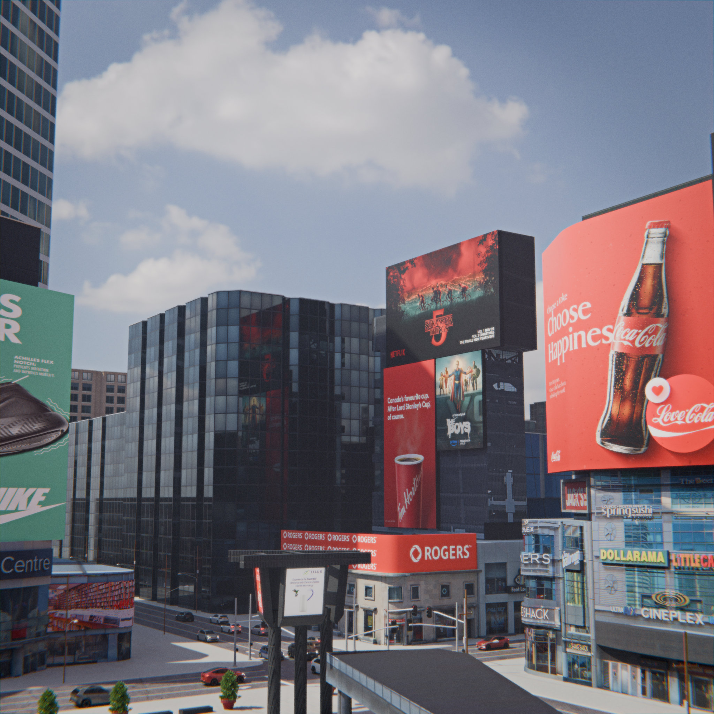
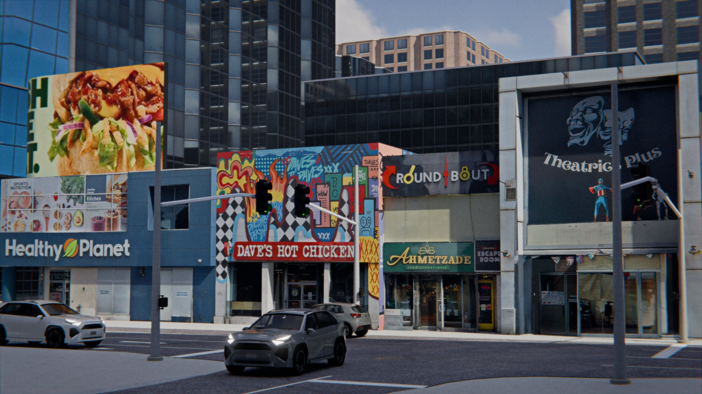
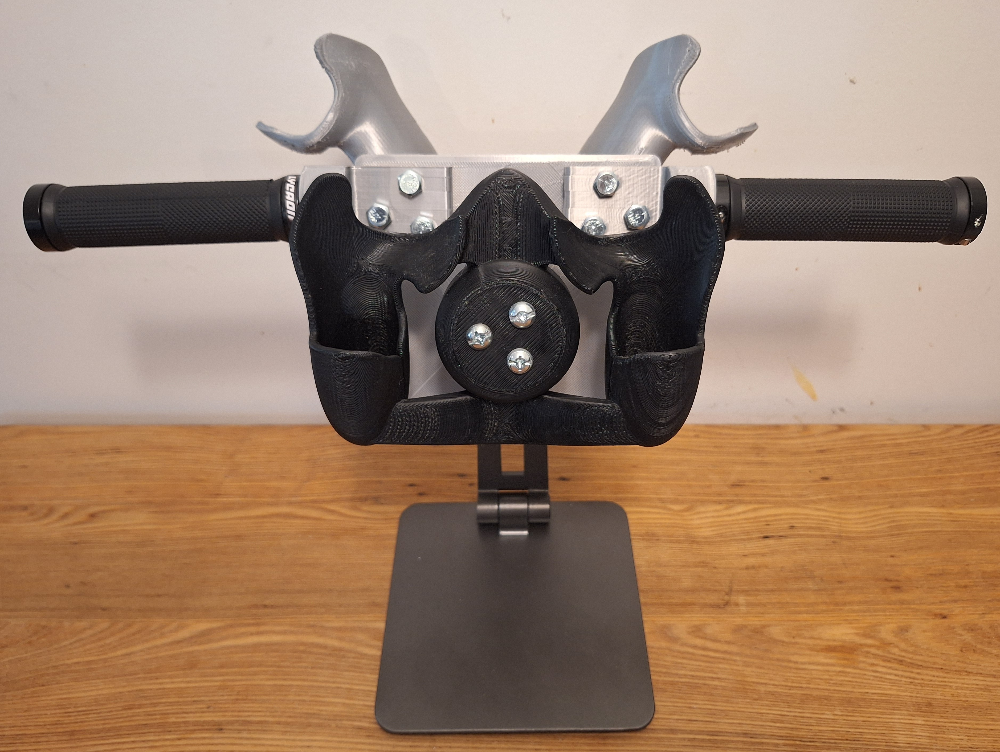
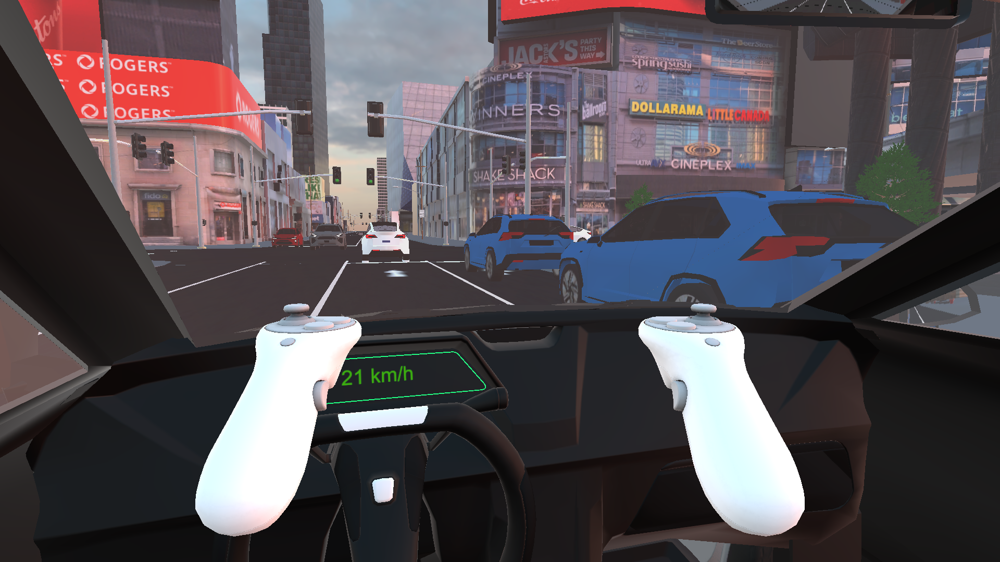

# VR Downtown Driving

VR can put non drivers or novice drivers in dangerous traffic situations at no risk. However, many existing VR driving simulators need expensive equipment like a gaming steering wheel or high end GPU. This project prototypes a system which is realistic, inexpensive, and tangible for educating people about driving. The setting is downtown Toronto (Yonge and Dundas) where it's often very busy and complex to drive.

The secondary goal is to see if experiencing the same scenario from both perspectives of car and bike can be helpful. There are 6 traffic scenarios for car and bike perspectives.

This was my undergraduate thesis project at Toronto Metropolitan University, supervised by Dr. Tim McInerney.

This project has 3 components:

- [Downtown Model](downtown_model/README.md): A geographically accurate and photorealistic 3D model of downtown Toronto, viewable on [Sketchfab](https://sketchfab.com/3d-models/downtown-toronto-yonge-and-dundas-a867077e68b8443297d682bf4a21a1af)
- [Controller](controller/README.md): A 3D printable steering wheel and bike handlebars controller for the VR simulation
- [Simulation](simulation/README.md): The Unity VR driving simulation with dynamic SUMO simulated traffic, playable in the browser on [itch.io](https://j03e.itch.io/downtown-driving)

| Downtown Model                                                              | Controller                                                  | Simulation                                                       |
| --------------------------------------------------------------------------- | ----------------------------------------------------------- | ---------------------------------------------------------------- |
|           |      |      |
