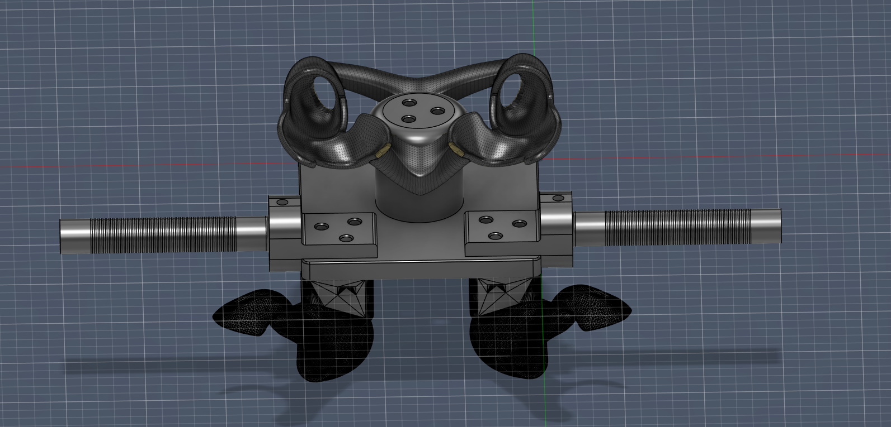
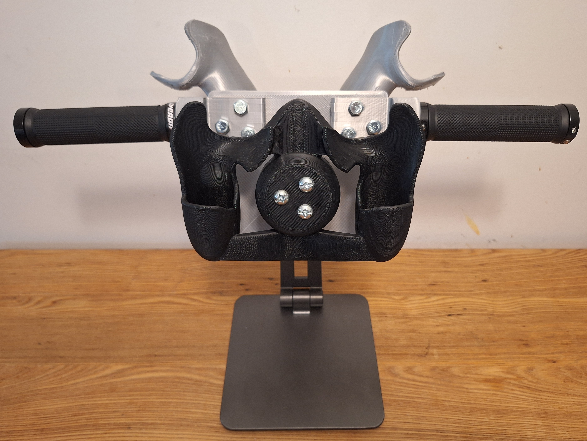
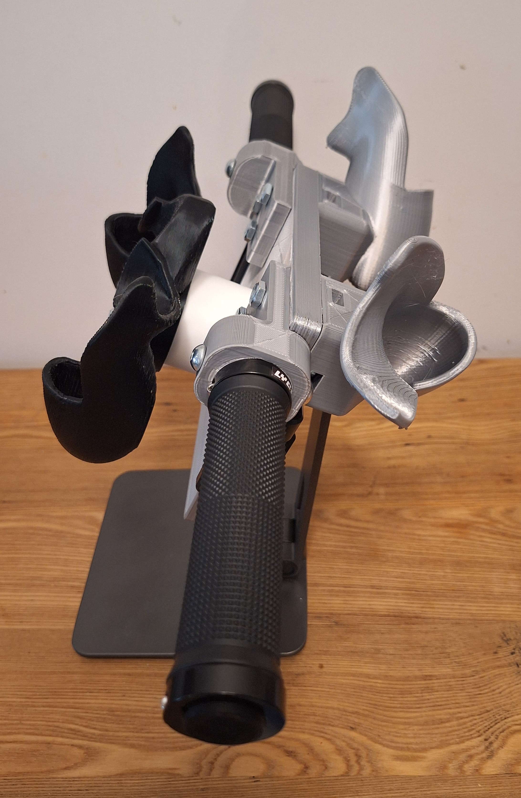
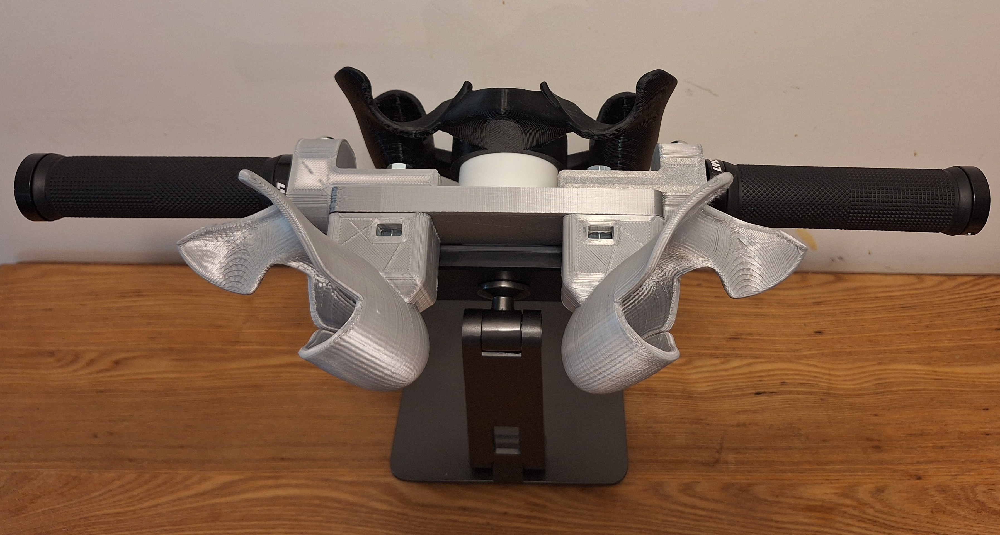
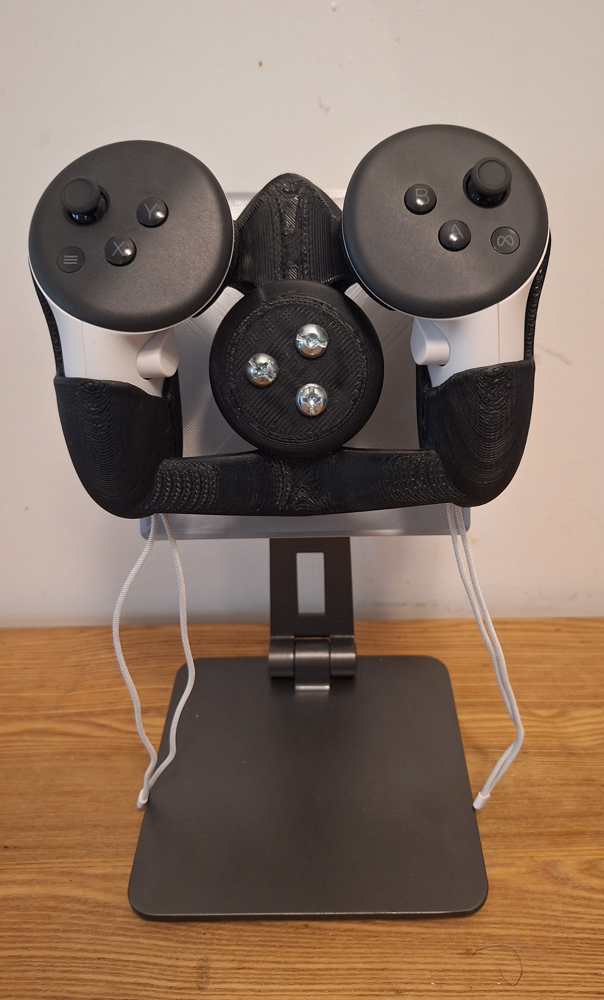
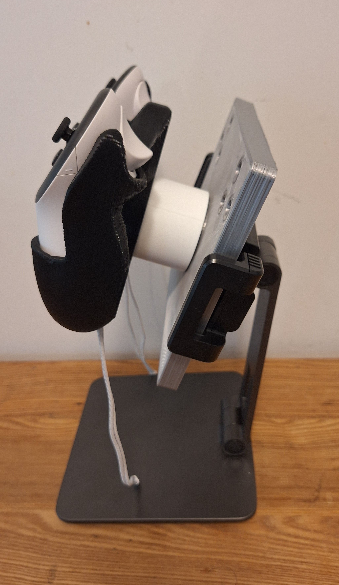
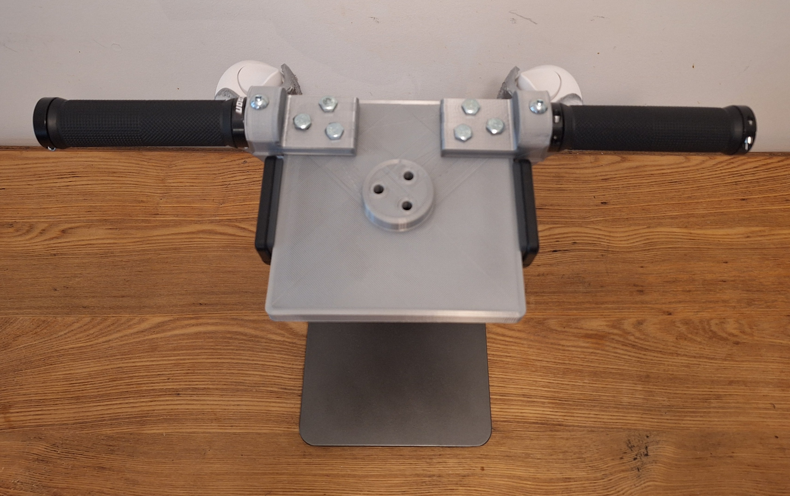
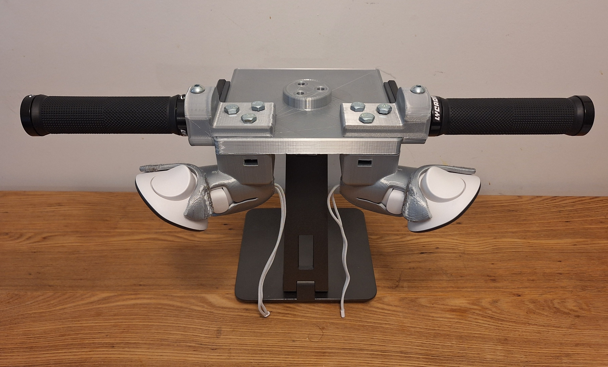

# Tangible Controller

This is a dual-purpose steering wheel and handlebars controller for VR (Meta Quest 3). The 3D printed controller fits on an iPad stand for simulating rotating a driving wheel and handlebars.

| Front                                                      | Side                                                     | Back                                                     |
| ---------------------------------------------------------- | -------------------------------------------------------- | -------------------------------------------------------- |
|  |  |  |

**Car mode**

| Front                                              | Side                                             |
| -------------------------------------------------- | ------------------------------------------------ |
|  |  |

**Bike mode**

| Front                                                | Back                                               |
| ---------------------------------------------------- | -------------------------------------------------- |
|  |  |

## Printing

The STL files are in this folder, and `Controller.f3z` is the Fusion 360 file. Print each piece separately, oriented to avoid supports where possible:

- `Handlebar.stl`: print vertically (auto orient in the slicer)
- `Steering Wheel.stl`: needs supports, print in normal orientation (auto orient)
- `Handlebar Bracket.stl`: print on its side, not vertically
- `Baseplate.stl`: print in normal orientation
- `Bicycle Cradle.stl`: needs supports, print upside down
- `Middle Cylinder.stl`: print upside down (auto orient)

This was printed on a Bambu A1 and an Anycubic Vyper with settings optimized for speed and strength and PLA material.

For Bambu Studio:
- 0.8 mm nozzle (0.4 mm layer height)
- 20% sparse infill density
- Tree supports when needed

For Anycubic (Ultimaker Cura slicer):
- Extra fast profile
- Adhesion type: skirt
- Line width: 0.48
- Wall thickness 2, wall line count 5
- Top/bottom thickness 2, top layers 4 and bottom layers 4
- Infill pattern gyroid
- Print speed 80, infill speed 100, travel speed 150
- Wall speed 50, inner wall speed 70, top/bottom speed 50
- Retraction speed: 45
- Support structure tree, placement buildplate only
- Support Z distance 0.3, XY distance 0.8, density 5%
- Support interface on, density 33%, pattern lines, roof height 0.6
- Support bottom interface off, bottom height 0.8
- Support tree top rate: 10

Filament used, about 626 g of PLA in total:

- Steering wheel: 180 g
- Baseplate: 137 g
- Middle cylinder: 44 g
- Both bicycle cradles: 151 g
- Both handlebar brackets: 55 g
- Both handlebars: 59 g

## Assembly

- Sand the support remains off the cradles
- Get 13 nuts and bolts, 1/4 inch:
  - 3 bolts 3 inch long for the middle cylinder
  - 4 bolts 3/4 inch long for the handlebars
  - 4 bolts 1 1/2 inch long and 2 bolts 2 inch long for the handlebar brackets and cradle
- The nuts go in the captive nut pockets in the printed parts
- Clamp the iPad stand onto the controller. Tighten the stand to make turning stiffer, and tilt it to switch between car and bike mode
- The Quest 3 controllers friction fit into the cradles
- (Optional): Put bike grips on the handlebars

## Parts from Amazon

- [iPad stand](https://www.amazon.ca/dp/B0937HSDD4) (SHUOSUO Tablet Stand)
- [Bike grips](https://www.amazon.ca/dp/B072KCZMPZ) (LYCAON Bike Handlebar Grips), optional

## Cost

In CAD, about $68 in total, or $79 with the bike grips:

- iPad stand: $44
- Nuts and bolts: $8
- PLA filament: $15.6
- Bike grips: $11.3

## Sources

- [Quest 3 Controller Art](https://developers.meta.com/horizon/downloads/package/oculus-controller-art/)
- [Base Steering Wheel Model](https://vrcg-paul.booth.pm/items/6812922)

The cradle was scaled up 1.5% from the original.